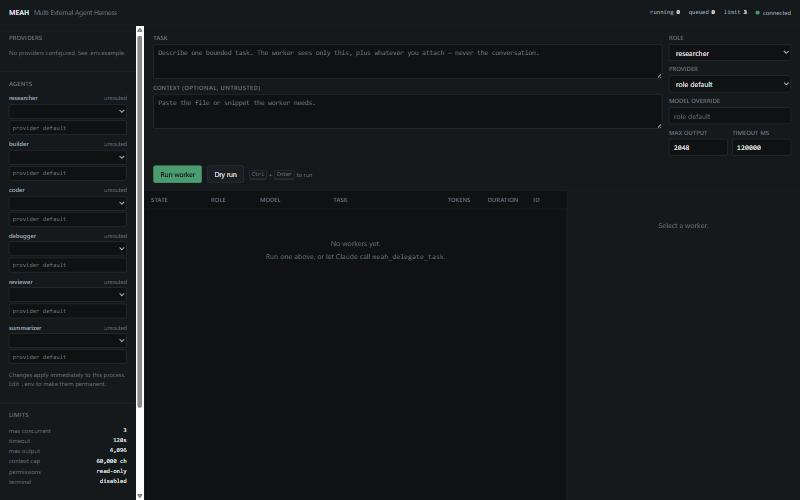

<div align="center">

# MEAH — Multi External Agent Harness

</div>

MEAH is a **local-first MCP server** that lets Claude delegate isolated units of work to **external LLMs** (Z.AI GLM, `https://aicredits.in/v1`, or any other OpenAI-compatible endpoint) through explicit MCP tools.



## Where MEAH sits relative to Claude

MEAH is an **extension layer, not a replacement**.

- Claude remains the orchestrator and the final reviewer. MEAH never intercepts, patches, or reimplements Claude's native subagent system.
- MEAH workers are _separate_ external agents that Claude calls on purpose, by name, with a bounded task.
- A worker has **no tools, no shell, no network, no filesystem outside its own workspace, and no access to the Claude conversation**. MEAH forwards only what the caller explicitly hands it.
- Worker output is data to review, never instructions. Nothing a model returns can change MEAH's policy, credentials, or permission boundaries.

---

## Quick start

```bash
npm install
cp .env.example .env        # then fill in your keys
npm start                   # web console at http://127.0.0.1:7817
```

`npm start` runs the **web console**: pick an agent, choose its model, run a worker, watch it live.

The **MCP server** is what Claude talks to, and it speaks stdio (so run on its own it looks idle — that's correct):

```bash
npm run mcp
```

To get both at once, with a single shared worker pool so the console shows the workers Claude spawns:

```bash
MEAH_WEB=true npm run mcp
```

### Console ownership

Only one process can serve the console port, and the one worth showing is whichever holds the worker pool Claude is using. So they negotiate:

- `npm start` runs a **yieldable** console. If a Claude-hosted MEAH later claims the port, it hands over, prints why, and exits.
- The MCP server (with `MEAH_WEB=true`) **preempts**: on a port clash it asks the incumbent to stand down, waits for the socket, and takes over.
- A console that owns a live pool refuses handover with `E_PERMISSION` — Claude's console is never displaced by a standalone one.
- If the port cannot be obtained at all, the console is skipped with a `console_unavailable` warning and **MCP keeps serving**. A dashboard problem never breaks Claude's connection.

The upshot: you never have to stop one before starting the other.

Requires Node.js ≥ 22.6 (TypeScript is run directly via type stripping). `npm run build` also emits plain JS to `dist/` if you prefer to run `npm run start:dist`.

---

## Configuration

Two interchangeable sources, both local and gitignored. Environment variables win over the file.

### Option A — environment variables

```bash
MEAH_PROVIDER_GLM_BASE_URL=https://api.z.ai/api/paas/v4
MEAH_PROVIDER_GLM_API_KEY_ENV=MEAH_GLM_API_KEY
MEAH_PROVIDER_GLM_MODEL=glm-4.5-air
MEAH_GLM_API_KEY=<your z.ai key>

MEAH_PROVIDER_AICREDITS_BASE_URL=https://aicredits.in/v1
MEAH_PROVIDER_AICREDITS_API_KEY_ENV=MEAH_AICREDITS_API_KEY
MEAH_PROVIDER_AICREDITS_MODEL=<a model your aicredits account has>
MEAH_AICREDITS_API_KEY=<your aicredits key>
```

The pattern is `MEAH_PROVIDER_<NAME>_BASE_URL | _API_KEY_ENV | _MODEL | _MODELS | _DESCRIPTION`. `<NAME>` lowercased becomes the provider name.

### Option B — `meah.config.json`

Copy `meah.config.example.json` to `meah.config.json` (gitignored) and edit. See `.env.example` for every supported variable.

### Two things to note about credentials

1. **`apiKeyEnv` names a variable; it never holds a key.** MEAH reads `process.env[apiKeyEnv]` at call time, never stores it on the config object, and never serializes it.
2. **No MCP tool accepts an API key, base URL, or headers as an argument.** There is deliberately no such field in any schema, so neither a caller nor text relayed from an untrusted source can point MEAH at a different endpoint or inject a key. Arguments are additionally scanned for key-shaped strings and rejected with `E_PERMISSION`.

`https://aicredits.in/v1` and Z.AI are configured **independently** — separate base URL, separate key variable, separate model catalog. MEAH never assumes one provider's models exist on another.

### Verified live against aicredits (2026-09-04)

`GET https://aicredits.in/v1/models` returns **406 active chat models** with OpenRouter-style ids (`vendor/model`), including the whole `z-ai/glm-*` family — so that one endpoint reaches GLM as well as OpenAI, Mistral, Llama and others. Observed on a live parallel run:

| Role       | Model                | Latency | Tokens | finish |
| ---------- | -------------------- | ------- | ------ | ------ |
| researcher | `z-ai/glm-4.6`       | 14.1 s  | 1490   | stop   |
| coder      | `z-ai/glm-4.7`       | 9.6 s   | 751    | stop   |
| summarizer | `openai/gpt-4o-mini` | 1.7 s   | 246    | stop   |

Two practical lessons from that run, both now handled:

- **GLM models are reasoning models.** They emit a `reasoning` field and can spend an entire small `maxOutputTokens` budget on it, returning `content: null` with `finish_reason: "length"`. Give them **2000+ output tokens**. MEAH detects exactly this case and returns `E_INVALID_REQUEST` telling you to raise the budget, rather than a confusing "malformed response". Reasoning text is never used as the result.
- **Not every listed model is actually up.** `mistralai/mistral-nemo` returned a gateway-relayed upstream `429`; MEAH classified it as a retryable `E_RATE_LIMIT` and gave up after the capped retries. If a model fails this way, pick another — `openai/gpt-4o-mini` was consistently fast and available.

---

## Connecting to Claude Desktop / Claude Code

### Claude Code

```bash
claude mcp add meah -- node --experimental-strip-types /absolute/path/to/MEAH/src/server.ts
```

Or, after `npm run build`:

```bash
claude mcp add meah -- node /absolute/path/to/MEAH/dist/src/server.js
```

### Claude Desktop

Edit `claude_desktop_config.json`
(macOS: `~/Library/Application Support/Claude/`, Windows: `%APPDATA%\Claude\`):

```json
{
  "mcpServers": {
    "meah": {
      "command": "node",
      "args": ["--experimental-strip-types", "C:/path/to/MEAH/src/server.ts"],
      "cwd": "C:/path/to/MEAH",
      "env": {
        "MEAH_PROVIDER_GLM_BASE_URL": "https://api.z.ai/api/paas/v4",
        "MEAH_PROVIDER_GLM_API_KEY_ENV": "MEAH_GLM_API_KEY",
        "MEAH_PROVIDER_GLM_MODEL": "glm-4.5-air",
        "MEAH_GLM_API_KEY": "sk-...",
        "MEAH_ROLE_RESEARCHER_PROVIDER": "glm",
        "MEAH_ROLE_CODER_PROVIDER": "glm",
        "MEAH_ROLE_REVIEWER_PROVIDER": "glm",
        "MEAH_ROLE_SUMMARIZER_PROVIDER": "glm"
      }
    }
  }
}
```

Restart Claude Desktop, then ask Claude to call `meah_list_models` to confirm the connection.

`cwd` matters: it determines where `meah.config.json` and `workspaces/` are resolved.

---

## Tools

| Tool                     | Purpose                                                                     |
| ------------------------ | --------------------------------------------------------------------------- |
| `meah_list_models`       | Configured providers, models, role routing, limits, runtime stats. No keys. |
| `meah_run_agent`         | Start one worker, return a `workerId` immediately.                          |
| `meah_delegate_task`     | Run one worker and block for the result.                                    |
| `meah_parallel_agents`   | Run up to 16 workers concurrently; results in request order.                |
| `meah_get_agent`         | State, timestamps, result or normalized error. Readable repeatedly.         |
| `meah_list_agents`       | All workers in this process, optionally filtered by state.                  |
| `meah_cancel_agent`      | Abort a queued/running worker; optionally remove its workspace.             |
| `meah_cleanup_workspace` | Delete a finished worker's workspace directory.                             |

Every handler returns a normalized envelope — `{ "ok": true, "data": ... }` or `{ "ok": false, "error": { "code", "message", "retryable", "hint" } }` — so a failure never breaks the protocol.

### Blocking calls and the MCP client timeout

MCP clients enforce their own per-request timeout — **60 s in Claude Desktop and Claude Code**. A blocking call that outruns it fails on the _client_ side even though the worker is healthy and still running.

So `meah_delegate_task` blocks for at most `min(timeoutMs + 5s, 50s)` by default, then returns the worker summary with a note telling you to poll `meah_get_agent`. Raise `waitMs` only if you know your client's timeout is higher. For anything slow — a large GLM job, several thousand output tokens — prefer `meah_run_agent` + `meah_get_agent`, which never blocks at all.

### Worker arguments

`task` (required), `role`, `provider`, `model`, `context[]`, `constraints[]`, `expectedOutput`, `timeoutMs`, `maxOutputTokens`, `temperature`, `permissionProfile`, `commands[]`, `label`, `dryRun`.

---

## Agents (roles)

Six worker agents. The role picks both the **routing default** and the **system prompt**, which is what actually makes them behave differently.

| Agent        | Job                                      | Distinguishing instruction                                                                                        |
| ------------ | ---------------------------------------- | ----------------------------------------------------------------------------------------------------------------- |
| `researcher` | Gather and weigh evidence                | Marks each claim (supplied) vs (background); never invents citations                                              |
| `builder`    | Create something that does not exist yet | Design first, then every file complete with full paths; no TODO placeholders                                      |
| `coder`      | Focused change to existing code          | Change the least that works; never elide code with `...` in a modified region                                     |
| `debugger`   | Symptom → root cause                     | Ranked candidate causes, then one committed root cause, a fix, and the cheapest way to confirm it before applying |
| `reviewer`   | Find real defects                        | Concrete failing scenario per finding; no style nitpicking; says so when it finds nothing                         |
| `summarizer` | Compress faithfully                      | Preserves numbers, negations and hedging; adds nothing                                                            |

`builder` vs `coder` is the distinction that matters most: builder writes new components end to end, coder edits what already exists.

## Model routing

Each role is routed independently — provider, model, and its own output budget:

```bash
MEAH_ROLE_DEBUGGER_PROVIDER=aicredits
MEAH_ROLE_DEBUGGER_MODEL=z-ai/glm-4.7
MEAH_ROLE_DEBUGGER_MAX_OUTPUT_TOKENS=3000
```

or in `meah.config.json`:

```json
{
  "roles": {
    "builder": { "provider": "aicredits", "model": "z-ai/glm-4.7", "maxOutputTokens": 4000 },
    "summarizer": {
      "provider": "aicredits",
      "model": "openai/gpt-4o-mini",
      "maxOutputTokens": 1000
    }
  }
}
```

`maxOutputTokens` precedence: value on the call → role default → `defaults.maxOutputTokens`. Roles differ a lot here: a summarizer needs a few hundred tokens, a debugger on a reasoning model can spend several thousand before emitting any answer.

A role may also carry `systemPrompt` (replaces the role prompt; the safety boundary is still appended) and `temperature`.

Selection order, with no silent guessing:

1. **Explicit** `provider` / `model` on the call.
2. **Role default** from `roles.<role>` in config.
3. **Sole provider** when exactly one is configured.
4. Otherwise → `E_INVALID_REQUEST` naming the configured providers.

```json
{
  "roles": {
    "researcher": { "provider": "glm", "model": "glm-4.5-air" },
    "coder": { "provider": "glm", "model": "glm-4.6" },
    "reviewer": { "provider": "glm", "model": "glm-4.6" },
    "summarizer": { "provider": "aicredits" }
  }
}
```

Roles also select the worker's system prompt (researcher / coder / reviewer / summarizer), which a `roles.<role>.systemPrompt` can override. The safety boundary and the required output sections are appended regardless of any override.

If a provider declares a `models` catalog, a model outside it is rejected for **that provider only**.

---

## Context policy

MEAH forwards only the bounded package the caller builds: `task`, `role`, the `context[]` items supplied, `constraints[]`, and `expectedOutput`. The Claude conversation is never forwarded — MEAH never receives it.

- Every context item is wrapped in `BEGIN/END UNTRUSTED` markers, and the system prompt instructs the worker to treat it as data, never as instructions.
- The prompt is capped at `defaults.maxContextChars` (60 000 by default). Items are truncated, then dropped, from the end; the prompt records what was omitted and the worker record reports `contextTruncated` and `droppedContext`.
- The result is capped at `defaults.maxResultChars` and passed through secret redaction before it reaches the caller.
- `dryRun: true` builds and validates the whole prompt without calling a provider.

---

## Permission profiles

| Profile                 | Workspace   | Context files | Result written | Terminal         |
| ----------------------- | ----------- | ------------- | -------------- | ---------------- |
| `none`                  | not created | —             | no             | no               |
| `read-only` _(default)_ | created     | materialized  | no             | no               |
| `workspace-write`       | created     | materialized  | `result.md`    | no               |
| `workspace-exec`        | created     | materialized  | `result.md`    | allowlisted only |

Every worker gets a unique directory under `workspaceRoot` (default `./workspaces/`, gitignored). Every path is resolved and checked against that directory: traversal (`..`), absolute paths, Windows drive and UNC paths, device paths (`NUL`, `\\.\PhysicalDrive0`, `/dev/*`, `/proc/*`), NUL bytes, and symlinks/junctions that resolve outside are all rejected with `E_PATH_ESCAPE`.

`workspace-exec` additionally requires `terminal.enabled` in the config — the profile alone is not enough. When enabled, each command is:

- checked against the `allowlist` (first token only),
- rejected outright if it contains shell metacharacters (`; & | > < \` $ ( ) { }`),
- spawned **without a shell**, pinned to the workspace as its cwd,
- given a **sanitized environment** — no `MEAH_*` variables and no provider keys ever reach a subprocess (`HOME`/`USERPROFILE` are pointed at the workspace),
- bounded by `timeoutMs`, `maxOutputBytes`, and `maxCommandsPerWorker`, and killed on cancellation.

Command output is appended to the prompt as another _untrusted_ context item.

---

## Lifecycle

```
queued → running → succeeded | failed | cancelled | timed_out
```

Every worker has an opaque unique id (`w_<20 hex>`), `createdAt` / `startedAt` / `finishedAt`, `durationMs`, an effective `timeoutMs`, and its resolved route. Concurrency is bounded by `defaults.maxConcurrent` (FIFO queue). Cancellation aborts the in-flight provider request and any child process, and a worker cancelled while queued never starts.

Results are **retrievable repeatedly** — `meah_get_agent` is not one-shot. State is in memory only and is lost on restart; full transcripts are retained only when `defaults.retainTranscripts` is enabled.

---

## Error behavior

| Code                   | Meaning                                                               | Retried |
| ---------------------- | --------------------------------------------------------------------- | ------- |
| `E_CONFIG`             | Missing/invalid config or an unset API-key variable                   | no      |
| `E_AUTH`               | 401/403 from the provider                                             | no      |
| `E_INVALID_REQUEST`    | Bad arguments, unknown provider/model, 400/404                        | no      |
| `E_RATE_LIMIT`         | 429                                                                   | yes     |
| `E_TIMEOUT`            | No response within `timeoutMs`                                        | no      |
| `E_CANCELLED`          | Cancelled by the caller or on shutdown                                | no      |
| `E_NETWORK`            | Connection failure                                                    | yes     |
| `E_MALFORMED_RESPONSE` | Non-JSON, wrong shape, or empty completion                            | no      |
| `E_PROVIDER`           | 5xx or an unclassified provider failure                               | yes     |
| `E_NOT_FOUND`          | Unknown worker id                                                     | no      |
| `E_PERMISSION`         | Profile violation, non-allowlisted command, credential in an argument | no      |
| `E_PATH_ESCAPE`        | Path leaves the workspace                                             | no      |
| `E_CONTEXT_TOO_LARGE`  | Task exceeds the context budget on its own                            | no      |

Only capped transient failures retry (`maxRetries`, default 2, exponential backoff from `retryBaseMs`). Auth and validation failures never retry.

**`timeoutMs` is a total budget, not a per-attempt one.** Retries share a single deadline, so N retries can never multiply the wall-clock time you asked for, and backoff is skipped rather than sleeping past the deadline.

The entire error object — message, hint and `details` — is deep-redacted before it leaves the process, as are results and retained transcripts.

---

## Logging

Structured JSON on **stderr** only — stdout is reserved for the MCP protocol. Levels: `debug|info|warn|error|silent` via `MEAH_LOG_LEVEL`. Configured key values and key-shaped strings are redacted from every log line, and sensitive field names (`authorization`, `api_key`, `token`, …) are dropped entirely.

---

## Testing

```bash
npm run typecheck     # tsc --noEmit, strict
npm run format:check  # prettier
npm test              # 96 unit + integration tests, no API key required
npm run smoke         # spawns the real MCP server over stdio, mock provider
```

Tests use the deterministic mock provider and cover config/redaction, path containment and symlink escapes, terminal sandboxing, context truncation, routing, provider normalization (every HTTP status, retries, timeout, cancellation, malformed responses), lifecycle transitions, parallelism and partial failure, and the full MCP tool surface.

### Opt-in live smoke test

This spends real tokens against your account:

```bash
MEAH_SMOKE_PROVIDER=glm \
MEAH_PROVIDER_GLM_BASE_URL=https://api.z.ai/api/paas/v4 \
MEAH_PROVIDER_GLM_API_KEY_ENV=MEAH_GLM_API_KEY \
MEAH_PROVIDER_GLM_MODEL=glm-4.5-air \
MEAH_GLM_API_KEY=... \
node --experimental-strip-types scripts/smoke.ts
```

Substitute `aicredits` and its own base URL / key variable / model to smoke-test that endpoint.

---

## Troubleshooting

**Claude does not list the tools.** Check `cwd` and use an absolute path to `server.ts`. Run the command manually — the server logs `server_ready` to stderr and then waits silently. Any startup failure prints one JSON line with an `E_CONFIG` error.

**`E_CONFIG: Missing API key: environment variable X is not set`.** MEAH reads the key from the environment _of the server process_. A shell `.env` is not inherited by Claude Desktop — put the variable in the `env` block of `claude_desktop_config.json`.

**`E_INVALID_REQUEST: Endpoint or model not found (HTTP 404)`.** The `baseUrl` usually needs its version prefix (`https://aicredits.in/v1`, `https://api.z.ai/api/paas/v4`) — MEAH appends `/chat/completions` itself. Otherwise the model name does not exist on that provider.

**`E_INVALID_REQUEST: No route for role "X"`.** More than one provider is configured and that role has no default. Add `roles.X` or pass `provider` explicitly.

**`E_MALFORMED_RESPONSE`.** The endpoint is not returning the OpenAI chat-completions shape (often an HTML error page from a proxy). The error `details` carry a redacted snippet.

**`E_INVALID_REQUEST: ... hit the N-token output limit`.** A reasoning model spent the whole budget thinking. Raise `maxOutputTokens` to 2000+, or route that role to a non-reasoning model.

**`MCP error -32001: Request timed out`.** That is your MCP client giving up, not MEAH. The worker is still running — call `meah_get_agent` with its id. Use `meah_run_agent` instead of `meah_delegate_task` for long jobs.

**`E_RATE_LIMIT` mentioning "All upstream providers failed".** A gateway relaying an upstream 429. The model is saturated, not your key; try another model.

**`E_PROVIDER: Provider server error (HTTP 500)` from aicredits on `z-ai/glm-*`.** Observed 2026-09-04: this gateway 500s consistently when `max_tokens` goes much above ~4000 on the GLM models, and was returning intermittent 500s for them at any budget. Verified by bisecting the same prompt across budgets — a trivial prompt at 8000 tokens succeeded while the same request repeated later failed, so it is upstream instability, not MEAH. Lower the role's `MAX_OUTPUT_TOKENS`, or route the role to `openai/gpt-4o-mini`, which was stable throughout.

**`E_PERMISSION: ... does not allow terminal access`.** Set `permissionProfile: "workspace-exec"` **and** `terminal.enabled: true`; both are required.

**Workspaces are piling up.** They are gitignored. Call `meah_cleanup_workspace`, set `defaults.cleanupWorkspaceOnFinish: true`, or delete `workspaces/*`.

**A key leaked into a transcript or a tracked file.** Rotate it immediately. MEAH will not copy a key into tracked files, but it cannot un-see one that was pasted.

---

## Repository layout

```text
src/server.ts                      MCP stdio entrypoint
src/config.ts                      config loading, validation, key resolution
src/errors.ts  src/redact.ts  src/logger.ts
src/providers/openai-compatible.ts adapter for Z.AI / aicredits / any compatible API
src/providers/mock.ts              deterministic offline provider
src/runtime/manager.ts             lifecycle, concurrency, cancellation
src/runtime/context.ts             bounded context packaging
src/runtime/workspace.ts           isolation and path containment
src/runtime/permissions.ts         profiles and the sandboxed terminal
src/routing/router.ts              role/model selection
src/tools/                         MCP tool schemas and handlers
tests/                             unit + integration tests (mock provider)
scripts/smoke.ts                   manual end-to-end MCP smoke test
```

## Non-goals

Replacing or modifying Claude's native subagents; pretending a worker has Claude's tools, memory, or authority; multi-user hosting or public deployment; unrestricted shell access; storing keys in source, logs, prompts, or git.

## License

[MIT](LICENSE)
